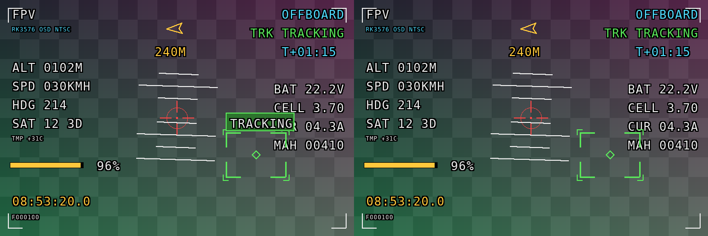
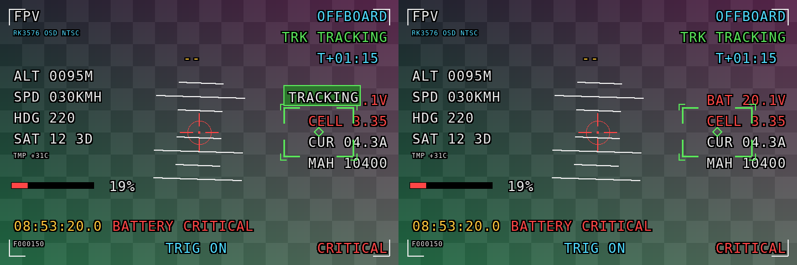

# 移除 OSD 目标标签的验证记录

2026-10-09 在本地 ARM64 容器完成代码构建、固定输入像素对照及三项针对性回归。目标框旁的整块标签面板已移除。其他 HUD 图形保持原样，显示提交日志的 `target_label` 字段固定为空。OSD 指视频上的屏幕信息叠加；HUD 指独立于目标框的遥测、状态和告警信息。

## 修改与覆盖范围

`src/osd/layout.cpp` 的公共目标元素删除标签文字、底色、边框和底板几何。目标缓存标识不再包含标签。目标绘制范围仍保留 8 像素外扩，并裁剪到视频与画布范围。`legacy` 是完整重绘路径，`cached-overlay` 是缓存及局部重画路径；二者共享本次修改。

`targetLabelText()` 始终返回空字符串，头文件说明同步更新。已核对 `src/osd/presenter.cpp`，其日志格式和独立状态栏逻辑保持原实现。右上角 `TRK TRACKING` 和任务触发后的 `ON MISSION` 继续有效。

| 检查 | 结果 |
|---|---|
| `osd_layout_tests` | 通过。空标签、短文本、80 字符长文本的目标输出一致，标签变化不重画目标。覆盖四种跟踪状态、720×480 与 1280×720、视频边缘小框、移动及清框。缓存结果与完整重绘一致。 |
| `osd_hud_style_tests` | 通过。原标签位置恢复底层内容，状态颜色、角框、锁定外角框、中心菱形及任务文字保留。另传入原快照目录，确认正常、告警和冻结 HUD 均与原实现一致。 |
| `osd_presenter_tests` | 通过。正常跟踪、任务触发和停止的日志标签为空。仅改变输入标签不会新增显示切换日志，两种后端模式均执行。任务覆盖与停止冻结检查保留。 |
| `git diff --check` | 通过，无补丁空白错误。 |
| `openspec validate remove-osd-target-label --type change --strict --json` | 通过，无规格校验问题。实施进度为 9/9，状态为 `all_done`，表示任务已全部完成。 |

测试使用合成状态、固定遥测及模拟显示后端，不加载 YOLO 或 NanoTrack 模型，也不读取相机或录制视频。

## 构建环境与命令

沿用 `AGENTS.local.md` 的现有容器镜像、挂载和构建缓存。启动原有 `ros2-arm64` 虚拟机后复用已安装镜像，没有重建镜像或安装依赖。

- 平台：Linux `aarch64`，Docker `linux/arm64`，容器禁用网络。
- 镜像：`drone-tracker-rk3576:humble-arm64-rknn2.3.2`。
- 镜像 ID：`sha256:620524fe768a8c7664a24c40504c86dfea35538d53b2da63b6dbf4cc4849293d`。
- 工具链：G++ 11.4.0，CMake 3.22.1，加载 ROS 2 Humble 环境。
- 已有配置：Release、`DRONE_TRACKER_PLATFORM=rk3576`、`DRONE_TRACKER_BUILD_TESTS=ON`。
- 容器 RKNN Runtime 2.3.2 的库 SHA-256 为 `d31fc19c85b85f6091b2bd0f6af9d962d5264a4e410bfb536402ec92bac738e8`，与约定值一致。

以下命令在归档前于容器的 `/work/ros2_ws` 下执行。只构建和运行与变更相关的三个目标，避免常规 `build.sh --test` 运行其他测试。归档后重现时，将命令中的 `openspec/changes/remove-osd-target-label` 替换为 `openspec/changes/archive/2026-10-09-remove-osd-target-label`。

```bash
source /opt/ros/humble/setup.bash
cmake --build build/drone_tracker \
  --target osd_layout_tests osd_hud_style_tests osd_presenter_tests -j 8
build/drone_tracker/src/osd/osd_hud_style_tests \
  src/drone_tracker/openspec/changes/remove-osd-target-label/evidence/after \
  src/drone_tracker/openspec/changes/remove-osd-target-label/evidence/before
ctest --test-dir build/drone_tracker --output-on-failure \
  -R '^osd_(layout|hud_style|presenter)_tests$'
```

CTest 结果为 3/3 通过，总耗时 1.90 秒。原实现的单目标构建及快照日志见 [baseline.log](evidence/baseline.log)。本次构建与回归日志见 [verification.log](evidence/verification.log)。环境证据见 [environment.log](evidence/environment.log)。

## 固定输入与视觉结果

输入、基线提交、时区和重现方式见 [inputs.md](evidence/inputs.md)。原快照保存于 `evidence/before/`，新快照保存于 `evidence/after/`。历史归档图未修改。并排图片均为左侧修改前、右侧修改后。

正常跟踪画面：



告警及框移动画面：



合成底图为固定渐变网格，便于观察标签原覆盖位置。对比结果如下，矩形按 `x,y,width,height` 表示，单位为像素：

| 画面 | HUD 变化像素 | 目标层变化像素 | 合成画面变化像素 | 变化所在矩形 | 原面板范围外变化像素 |
|---|---:|---:|---:|---|---:|
| 正常跟踪 | 0 | 5312 | 5136 | `(459,229,140,38)` | 0 |
| 告警及移动 | 0 | 5312 | 5049 | `(512,154,140,38)` | 0 |
| 冻结 | 0 | 无目标装饰 | 无 HUD 变化 | 无 | 0 |

原面板上部没有任何目标层像素，因此文字、底色及边框均已消失。每块原面板中有 5278 个位置恢复为底图或 HUD。其他位置保留原有锁定装饰；不能要求整个原面板矩形全部透明。目标层变化数与合成画面变化数不同，是因为部分底层 HUD 像素与原面板像素相同。

完整数值见 [pixel-diff.json](evidence/pixel-diff.json)。[正常差异图](evidence/normal-difference.png) 和 [告警差异图](evidence/alert-difference.png) 以粉色标出实际变化像素。可在仓库根目录使用现有 conda base Python 重现像素检查及合成图：

```bash
python openspec/changes/archive/2026-10-09-remove-osd-target-label/evidence/compare_snapshots.py
```

## 未执行的检查

按本次范围，没有连接开发板或生产板，没有部署或启动实机程序。未执行生产板 HDMI 验收、相机采集、真实模型推理、持续负载、长期稳定性或性能测试。这些软件结果不能替代实机验收。

现有容器没有 `clang-tidy` 或 `clangd`，仓库也没有配置对应检查命令。因此未执行这两项 C++ 静态检查；已完成编译、针对性功能回归和补丁检查。
